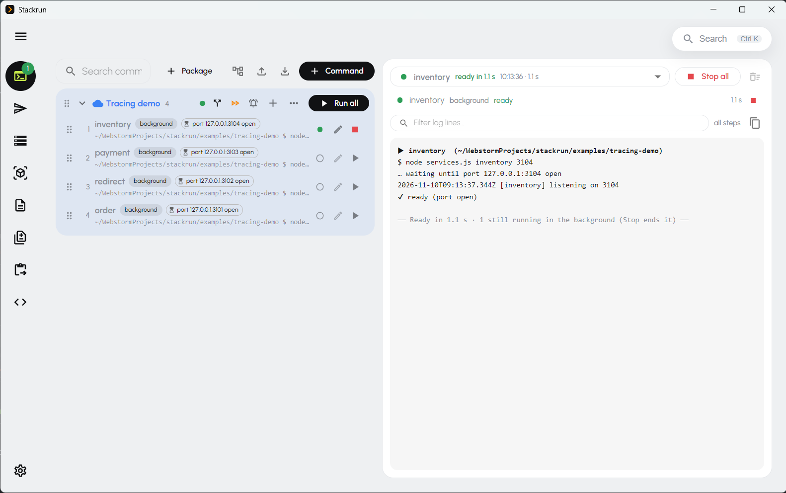

# Stackrun

**A macOS app for the everyday chores of running a local dev stack** – start your
services, call your APIs, query your databases, watch Docker, and see how a request
travels through your services.



**[⬇ Download for macOS](../../releases/latest)** · Apple Silicon & Intel · macOS 10.13 or newer

*Windows and Linux versions are coming soon.*

## Features

- **Commands** – start your whole dev stack with one click: packages of steps, run in order or all at once
- **Packages inside packages** – build bigger setups from smaller ones; nested packages are tucked away
- **"Ready when" checks** – wait for a port, a URL, a healthy container or a log line before the next step
- **Live logs** per step, retry only the failed step, stop / force-kill, rerun from any step
- **Port already in use?** – see who holds it, kill it and retry in one click
- **macOS notifications** when a package is done, fails, or its servers are up
- **HTTP Client** compatible with WebStorm / IntelliJ `.http` files – collections, environments, variables, OAuth 2.0
- **`.http` editor** with syntax colouring – edit, paste and run a whole file
- **Dynamic variables** – `{{$uuid}}`, `{{$guid}}`, `{{$timestamp}}`, `{{$random.integer(1, 100)}}`…
- **Request history** – the last 100 calls with their responses, for all requests or just one
- **Favorites**, colour-coded and temporary collections, drag & drop between collections
- **cURL import and export** – paste a cURL, or copy any request as cURL with variables filled in
- **Request tracing** – see how a call travels through your services: diagram, timeline and each service's logs
- **Zero-setup tracing** for NestJS, Express, Node, Angular dev server and Azure Functions – no code changes
- **Databases on the trace** – PostgreSQL, MySQL, MongoDB, Redis… shown as their own nodes
- **"Why not traced?"** – Stackrun tells you why a service sent nothing
- **DB Client** for PostgreSQL, MySQL / MariaDB and MongoDB in your Docker containers
- **Search and filter** result rows by any column, copy as CSV
- **"Time it"** – compare a query's speed before and after a change
- **Database snapshots** – save a state and restore it later
- **Docker** – containers, volumes, logs, connection strings, compose projects
- **Notes** – Markdown, JSON, SQL and HTTP notes with notebooks, tags and version history
- **JSON compare**, **cURL → .http**, **Base64**
- **⌘K search** across notes, commands, HTTP requests (name, path, headers, comments) and tools
- **Update notice** – the app tells you when a new version is out
- **Local only** – your data never leaves your Mac

---

## In detail

### ▶ Commands – your stack in one click
- Save the commands you run all the time and group them into **packages**: `git pull`,
  `npm install` (only when dependencies changed), NestJS / Angular / Azure Functions dev
  servers, Docker containers…
- Steps run **one after another or all at once**; packages can contain other packages.
- **"Ready when"** checks – a port is open, a URL answers, a container is healthy, a line
  shows up in the log – so the next step starts only when the previous one is really up.
- Live logs per step, **retry just the failed step**, stop or force-kill, rerun from any step.
- **Port already in use?** Stackrun shows who holds it and offers to kill it and retry.
- macOS **notifications** when a package is done, fails, or its servers are up.

### ⇄ HTTP Client – compatible with WebStorm / IntelliJ `.http` files
- Collections, environments, variables, captured values (`client.global.set`),
  OAuth 2.0, Bearer / Basic / API key auth.
- Open a whole collection as a **`.http` file** – edit, paste and run it like in the IDE,
  with syntax colouring.
- **History** of the last 100 calls with their responses – for all requests or just one.
- **Favorites**, colour-coded collections, temporary collections for parked copies,
  drag & drop between collections.
- Paste a **cURL** to import a request, or **copy any request as cURL** with variables filled in.
- Links in responses open in a **private / incognito** browser window.

### ◎ Request tracing – see how a call goes through your services
- Turn on **Trace** for a request: Stackrun follows it through every service it reaches
  and draws who called whom, with a **timeline** and the **logs of each service** at that moment.
- **Nothing to install in your services**: tick *Trace* on a command and Stackrun runs it
  with OpenTelemetry. Works with **NestJS, Express, Node, Angular dev server (proxy)
  and Azure Functions**; databases (PostgreSQL, MySQL, MongoDB, Redis…) show up as their
  own nodes.
- When a service sends nothing, Stackrun tells you **why** (Trace off, the agent did not
  load, the port belongs to another process…).
- Uses a local Jaeger in Docker, started for you.

### 🗄 DB Client – PostgreSQL, MySQL / MariaDB, MongoDB
- Connects to the databases in your Docker containers without setup.
- Search and filter result rows by any column, copy as CSV.
- **"Time it"** – measure a query before and after a change (indexes, schema) and compare.
- Snapshots: save a database state and restore it later.

### 🐳 Docker
- Containers and volumes, logs, start / stop / restart, connection strings, compose projects.

### 🧰 And more
- **Notes** (Markdown, JSON, SQL, HTTP) with notebooks, tags and version history.
- **JSON compare**, **cURL → .http**, **Base64**.
- **⌘ K** – search everything: notes, commands, HTTP requests (by name, path,
  headers or comments), tools.

---

## Install

| Your Mac | File |
| --- | --- |
| Apple Silicon (M1, M2, M3, M4…) | `Stackrun-<version>-arm64.dmg` |
| Intel | `Stackrun-<version>.dmg` |

Not sure which one?  → About This Mac: *Chip: Apple M…* means Apple Silicon.

> **Windows / Linux:** coming soon – watch this repository (*Watch → Custom → Releases*)
> to hear when they are out.

1. Open the `.dmg` and drag **Stackrun** to **Applications**.
2. Stackrun is not signed with an Apple Developer certificate yet, so the first time
   macOS blocks it ("can't be opened" / "is damaged"). Right-click Stackrun in
   Applications → **Open** → **Open**, or in Terminal:

   ```sh
   xattr -cr /Applications/Stackrun.app
   ```
3. Allow notifications when asked (System Settings → Notifications → Stackrun) to hear
   when your packages are done.

New versions are published on the [Releases](../../releases) page – download and install
over the old one; your data stays.

## Requirements

- **Docker Desktop**, **Colima** or **OrbStack** for the Docker tools, the DB Client and
  request tracing.
- **Node.js / npm** on your machine for tracing Node services (Stackrun installs the
  OpenTelemetry agent once, in its own folder).

## Your data

Everything stays on your Mac, in the app's data folder (`stackrun-data.json` – Settings
shows where it is and opens it). Nothing is sent anywhere.

## Feedback

Found a bug or have an idea? Open an [issue](../../issues).
